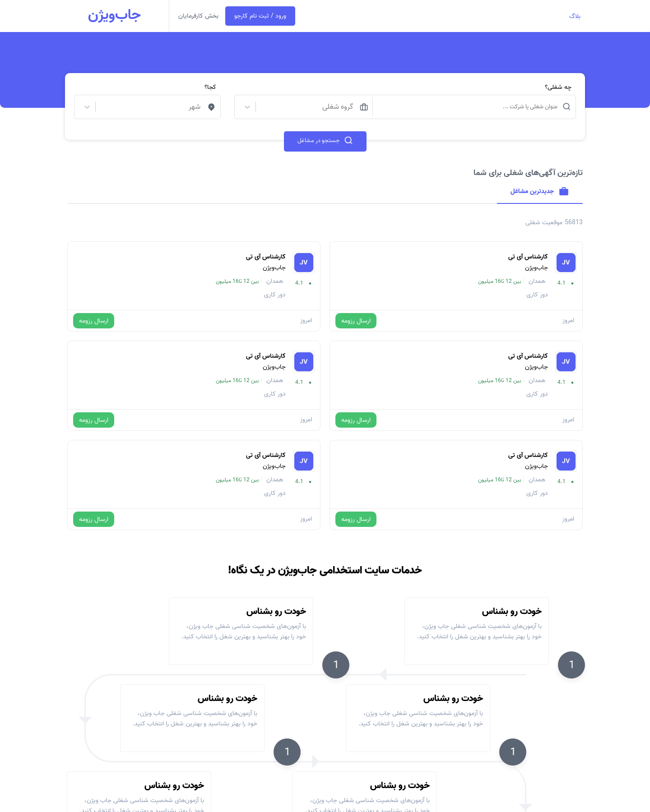
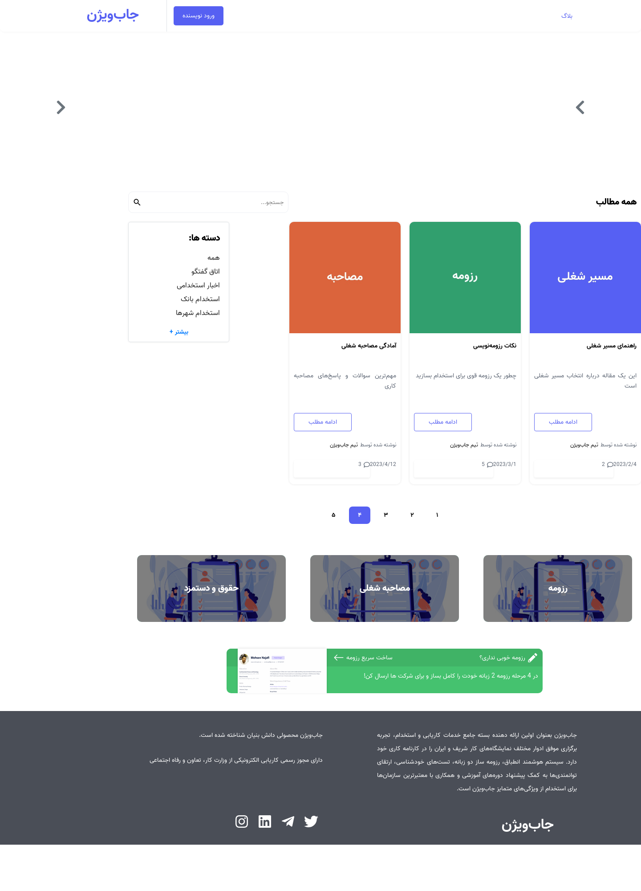
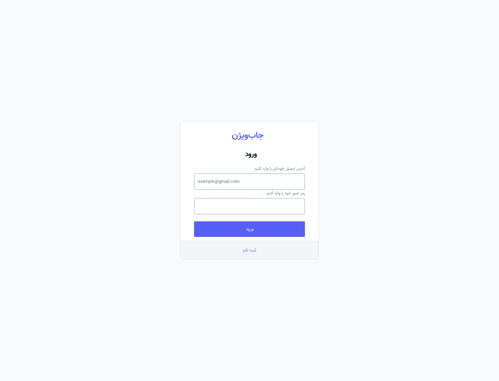
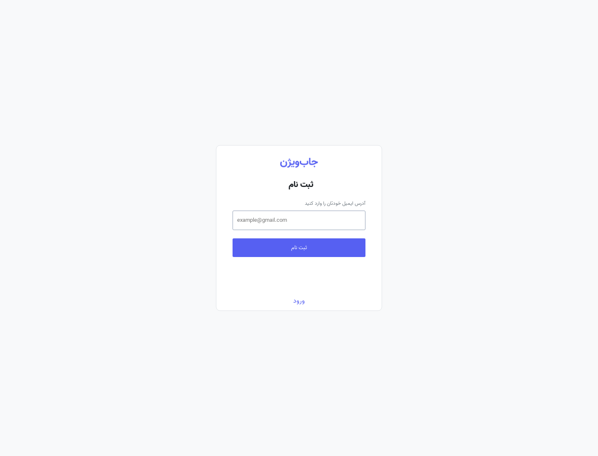
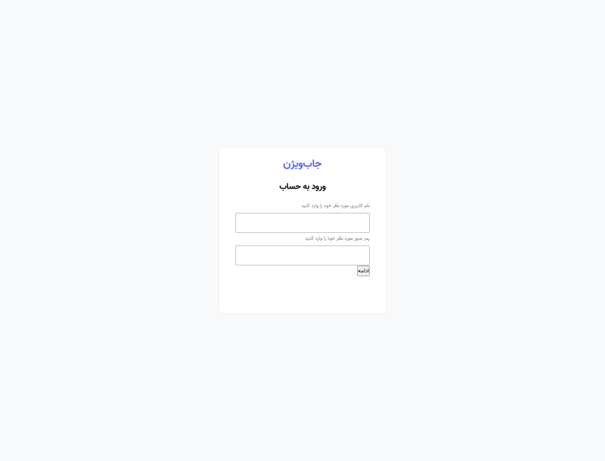
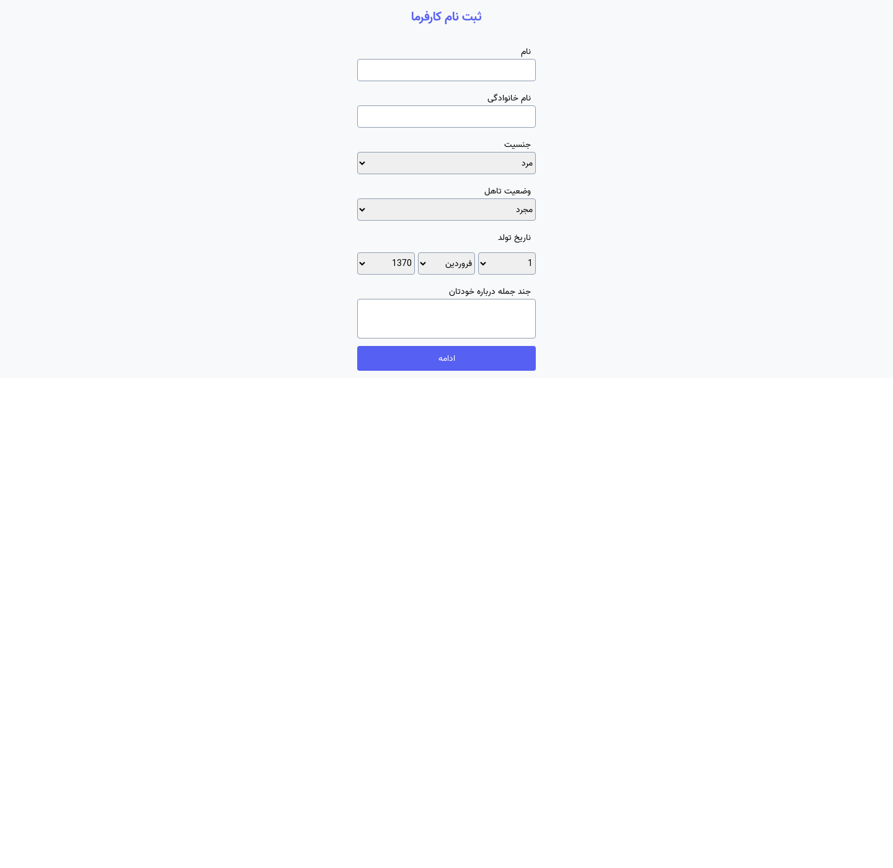

<p align="center">
  
</p>

<h1 align="center">WoodenDoor</h1>

<p align="center">
  <strong>A modern job marketplace API</strong><br/>
  Connect job seekers with employers — post listings, manage companies, and grow careers.
</p>

<p align="center">
  <a href="https://cafejoon.ir/jobvision/"></a>
  
  
  
  
  
</p>

<p align="center">
  <a href="#features">Features</a> ·
  <a href="#screenshots">Screenshots</a> ·
  <a href="#tech-stack">Tech Stack</a> ·
  <a href="#getting-started">Getting Started</a> ·
  <a href="#api-overview">API</a> ·
  <a href="#testing">Testing</a>
</p>

---

## Overview

**WoodenDoor** is a full-featured recruitment platform backend built with Laravel. It powers a dual-sided marketplace where:

- **Job seekers** create profiles, browse openings, and apply for roles
- **Employers** register companies, publish job ads, and reach qualified candidates
- **Everyone** can engage with a built-in career blog — posts, comments, reactions, and bookmarks

The API is designed for a SPA frontend, secured with token-based authentication and role-based access control.

> **Live demo:** [cafejoon.ir/jobvision](https://cafejoon.ir/jobvision/)

---

## Features

### Authentication & identity
- Sign-up / sign-in for **employees** and **employers**
- Verification-code flow for account confirmation
- Token authentication via **Laravel Sanctum**
- Role & permission management with **Spatie Laravel Permission**

### Job marketplace
- Job ad CRUD with rich filters (location, salary, cooperation type, experience, education)
- Job categories and company profiles
- Employer-owned companies with logos and staff metadata
- Ad lifecycle statuses: waiting → active / failed / needs correction

### Candidate profiles
- Employee profile (province, salary expectations, job position)
- Work & education experience records
- Skills associated with job listings

### Career blog
- Posts with categories and authors
- Nested comments
- Like / dislike reactions
- Bookmark (store) posts for later

### Platform quality
- Authorization policies for companies and job ads
- Feature test suite covering core domains
- Docker Compose / Sail-ready deployment
- Rate-limited API (`60 req/min`)

---

## Screenshots

| Homepage | Blog |
|:---:|:---:|
|  |  |

| Login | Register |
|:---:|:---:|
|  |  |

| Set password | Employer registration |
|:---:|:---:|
|  |  |

---

## Tech Stack

| Layer | Technology |
| --- | --- |
| Framework | [Laravel 10](https://laravel.com) |
| Language | PHP 8.1+ |
| Database | MySQL 8 |
| Auth | [Laravel Sanctum](https://laravel.com/docs/sanctum) |
| Authorization | [spatie/laravel-permission](https://github.com/spatie/laravel-permission) |
| HTTP client | Guzzle |
| Frontend (companion) | React SPA (integrated separately) |
| Tooling | Vite, PHPUnit, Laravel Pint, Laravel Sail |
| Containers | Docker Compose |

---

## Architecture

```
┌─────────────────┐     Sanctum token      ┌──────────────────────────┐
│  React SPA      │ ─────────────────────► │  Laravel API (/api)      │
│  (frontend)     │ ◄───────────────────── │  Controllers v1          │
└─────────────────┘       JSON             │  Models · Policies · RBAC│
                                           └────────────┬─────────────┘
                                                        │
                                                        ▼
                                                 ┌─────────────┐
                                                 │   MySQL 8   │
                                                 └─────────────┘
```

**Roles**

| Role | Capabilities |
| --- | --- |
| `Employee` | Job seeker profile, browse & engage with listings and blog |
| `Employer` | Manage companies, publish and maintain job ads |

API routes are versioned under `app/Http/Controllers/v1` and modularized in `routes/Api/`.

---

## Getting Started

### Prerequisites

- PHP **8.1+** with extensions: `pdo`, `mbstring`, `openssl`, `tokenizer`, `xml`, `ctype`, `json`, `bcmath`
- Composer 2
- MySQL 8 (or Docker)
- Node.js 18+ (optional, for asset tooling / frontend integration)

### 1. Clone the repository

```bash
git clone https://github.com/alizeinodin/woodenDoor.git
cd woodenDoor
```

### 2. Install PHP dependencies

```bash
composer install
```

### 3. Environment configuration

```bash
cp .env.example .env
php artisan key:generate
```

Update database credentials in `.env`:

```env
DB_CONNECTION=mysql
DB_HOST=127.0.0.1
DB_PORT=3306
DB_DATABASE=woodendoor
DB_USERNAME=woodendoor
DB_PASSWORD=secret
```

### 4. Migrate & seed

```bash
php artisan migrate
php artisan db:seed
```

Seeders include roles/permissions, job categories, post categories, and sample users.

### 5. Run the application

```bash
php artisan serve
```

The API is available at `http://127.0.0.1:8000/api`.

### Docker (optional)

A Compose stack is provided for app + MySQL:

```bash
docker compose up -d
```

Ensure the external network referenced in `docker-compose.yml` exists, or adjust it for your environment.

### Frontend integration (optional)

The UI lives in a companion React app. Use the helper script to clone, patch paths, and build into Laravel’s `public/` directory:

```bash
./scripts/integrate-frontend.sh
```

---

## API Overview

All endpoints are prefixed with `/api` and (unless noted) require a Sanctum bearer token.

### Auth & verification

| Method | Endpoint | Description |
| --- | --- | --- |
| `POST` | `/sign-up` | Register as employee or employer |
| `POST` | `/sign-in` | Authenticate and receive token |
| `GET` | `/logout` | Revoke current token |
| `POST` | `/verification_code/request` | Request verification code |
| `POST` | `/verification_code/verify` | Verify code |

### Marketplace

| Resource | Endpoints |
| --- | --- |
| Companies | `POST /companies/my-companies`, full REST via `/company` |
| Job ads | `POST /job_ad/my-jobAds`, `POST /job_ad/store/{company}`, REST `/job_ads` |
| Job categories | `/job_category`, plus companies & ads by category |

### Blog

| Resource | Endpoints |
| --- | --- |
| Posts | REST `/post` |
| Post categories | `/post_category`, `{id}/posts` |
| Comments | Nested tree: children / parent helpers under `/comments` |
| Reactions | `/reaction/likeOrDislike`, `/reaction/delete` |
| Bookmarks | `/store_post/store/{post}`, `/unStore/{post}`, user & post queries |

> Authenticate with: `Authorization: Bearer {token}`

---

## Project Structure

```
app/
├── Enum/                  # Domain enums (reactions, verification status)
├── Http/
│   ├── Controllers/v1/    # Versioned API controllers
│   ├── Middleware/
│   ├── Requests/          # Form request validation
│   └── Resources/
├── Models/                # Eloquent models (User, JobAd, Company, Post, …)
├── Policies/              # Authorization (Company, JobAd)
└── Providers/
database/
├── migrations/
├── seeders/
└── factories/
routes/
├── Api/                   # Modular API route files
├── api.php
└── web.php                # SPA catch-all
tests/Feature/             # Feature tests per domain
docs/
├── logos/
└── portfolio/             # Product screenshots
```

---

## Testing

Feature tests cover authentication, companies, job ads, categories, posts, comments, reactions, bookmarks, uploads, and verification codes.

```bash
php artisan test
# or
./vendor/bin/phpunit
```

Ensure a testing database is configured (see `phpunit.xml` and your `.env.testing` if used).

---

## Configuration tips

| Concern | Recommendation |
| --- | --- |
| File uploads | Configure `FILESYSTEM_DISK` and ensure `storage:link` |
| Mail (verification) | Set `MAIL_*` for real SMTP in production; Mailpit works locally |
| SPA routing | `routes/web.php` serves the frontend catch-all view |
| Permissions | Run `RoleAndPermissionSeeder` after migrate |

```bash
php artisan storage:link
```

---

## Contributing

Contributions are welcome.

1. Fork the repository
2. Create a feature branch (`git checkout -b feature/your-feature`)
3. Commit with a clear message
4. Open a pull request against `master`

Please keep changes focused, follow existing code style (Laravel Pint), and add or update tests when changing behavior.

---

## Security

If you discover a security vulnerability, please open a private advisory or contact the maintainer directly rather than filing a public issue.

---

## License

This project is open-source software licensed under the [MIT license](https://opensource.org/licenses/MIT).

---

<p align="center">
  Built with Laravel · Designed for real hiring workflows
</p>
